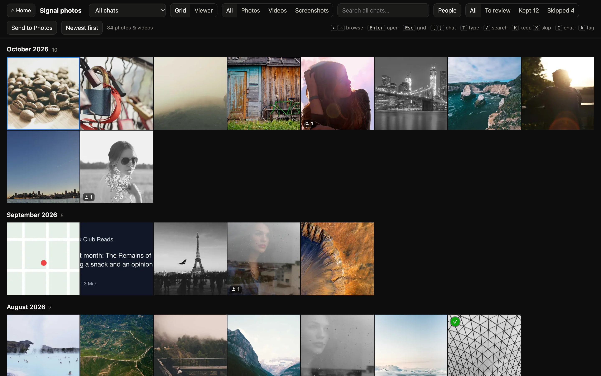
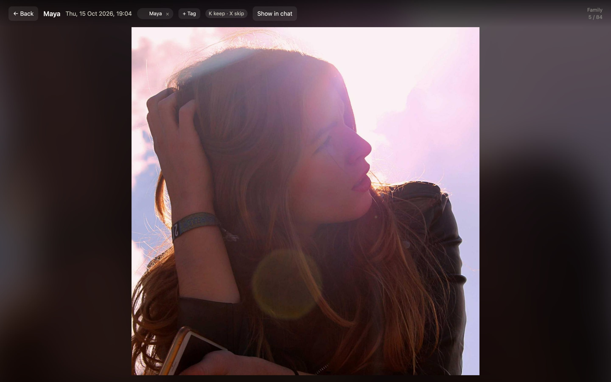
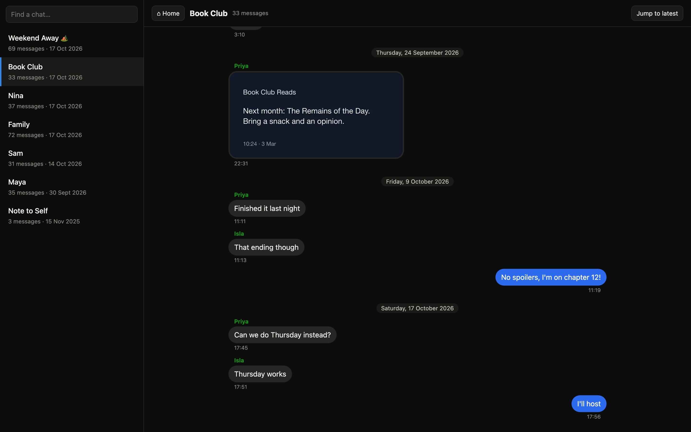
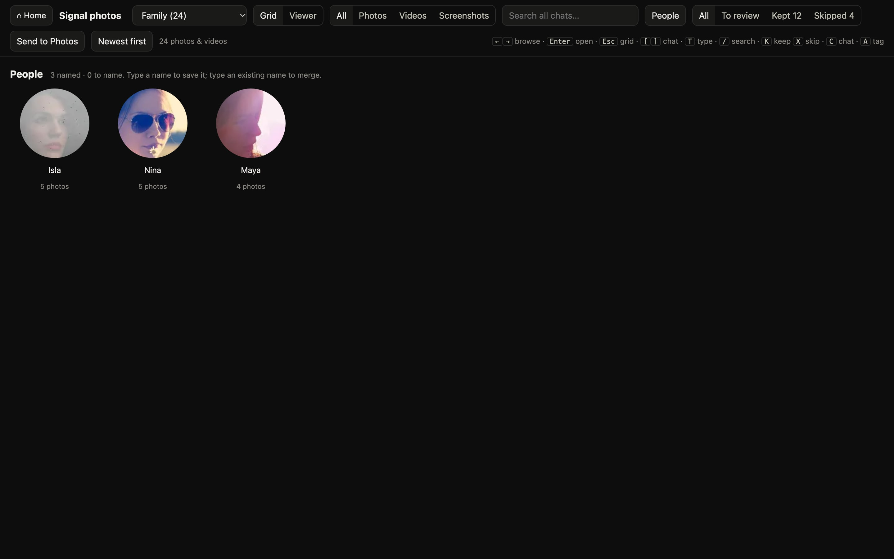
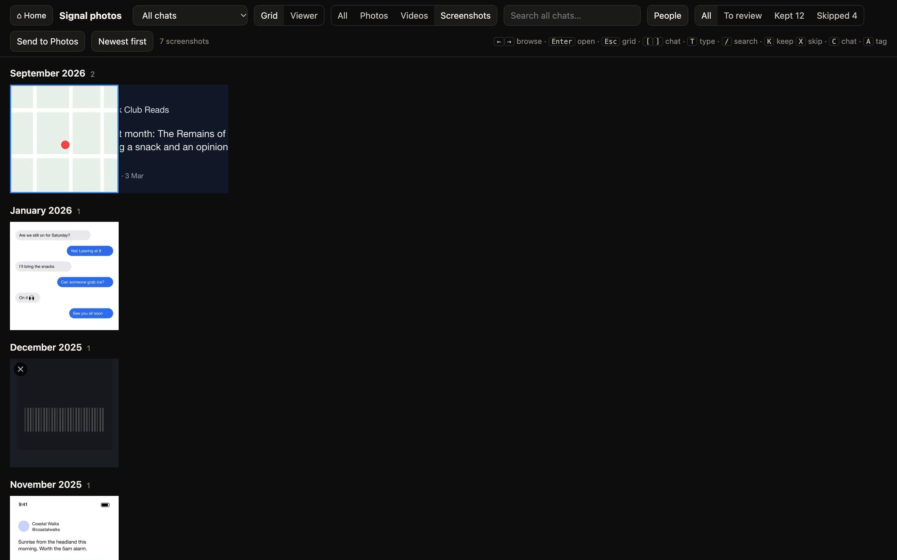

# Media Exporter for Signal

Get the photos and videos out of your Signal chats, keep the ones you care about, and free up space on your phone.

Signal stores everything encrypted inside the app, so years of shared photos pile up on your phone with no way to export them. Media Exporter for Signal decrypts your own Signal backup on your Mac and turns it into normal files, then gives you tools to sort through them: a photo viewer, a chat viewer, screenshot detection, search, face grouping, and one click to send the keepers to Apple Photos.

Everything runs locally on your Mac. Nothing is uploaded anywhere.



> **iPhone only, for now.** This reads the on-device backups that **Signal for iPhone 8.30 and later** can make. Android backups use an older, different format and aren't supported yet. Signal Desktop's local backups use the same format as the iPhone's and may work, but haven't been tested.
>
> This is an unofficial tool, not made by or affiliated with Signal.

## What you get

- **Every photo, video, voice note and file** as normal files, in a folder per chat and per year, named and dated by when they were sent.
- **A home page** with your totals, triage progress and "on this day" photos from earlier years.
- **A photo viewer:** a fast grid for every chat (or all chats at once), and a full-screen view you step through with the arrow keys. It shows who sent each photo and when.
- **A chat viewer** with message bubbles. Jump from any photo to that exact moment in the conversation, and back.
- **Screenshot detection:** screenshots and memes go in their own tab, so the Photos tab shows real photos.
- **Search** by description ("beach", "birthday cake", "dog") across every chat.
- **People:** faces in photos and videos are grouped by person. Name each group once, then filter by person. You can also tag people by hand.
- **Triage:** press K to keep or X to skip, then send everything you kept to Apple Photos, dated correctly.
- **A storage dashboard** showing which chats and files take up the most space on your phone.
- **Safe to clean up afterwards:** the archive only ever grows. Media you delete from your phone stays in the archive, and the viewer still shows it.

| | |
|---|---|
|  |  |
| **Viewer:** who sent it, when, and who's in it | **Chats:** jump from any photo to the conversation |
|  |  |
| **People:** faces grouped across photos and videos | **Screenshots:** kept out of your photos |

*Screenshots are from the [demo](#try-the-demo-first): made-up chats with free stock photos.*

## What you need

- A Mac with Apple Silicon. Intel Macs work but face and screenshot detection run more slowly.
- [Node.js](https://nodejs.org) 22 or newer.
- Apple's command line tools, for the screenshot text checks: `xcode-select --install`
- Signal for iPhone 8.30 or newer.
- Free disk space of roughly twice your Signal media: once for the encrypted backup and once for the decrypted archive, plus about 10% for thumbnails and indexes.

## Try the demo first

You can see everything working on a made-up archive before using your own backup:

```bash
npm install
npm run setup
npm run demo:build
npm run demo
```

This builds a demo with seven chats, a few hundred messages, photos, screenshots, videos and three people, as a real encrypted Signal backup. Then it opens the app at `http://127.0.0.1:8780`. The demo lives in `demo/data/` and never touches your own archive. Its photos come from [Lorem Picsum](https://picsum.photos) (Unsplash photos, free to use); the people's names are made up.

## 1. Make a backup on your iPhone

1. Update Signal to version 8.30 or newer.
2. In Signal, open **Settings → Backups** and turn on the **on-device** (local) backup. The exact labels may vary slightly between versions.
3. Choose where to save it. You can use a folder on your iPhone, a USB drive, or your Mac directly (see option C below, which uses no phone storage).
4. **Save your recovery key.** It's 64 characters, and Signal can save it to your password manager. You need it to decrypt the backup. Anyone who has it can read your backups, so keep it private.

   The iPhone shows every `0` as `=` and every letter `O` as `#`, so the key will contain `=` and `#` characters. That's expected: enter it exactly as shown and it translates them back.
5. Let the backup finish. You'll end up with a folder called `SignalBackups` containing a `files` folder and one or more `signal-backup-…` folders.

## 2. Copy the backup to your Mac

**A. AirDrop** (simplest)

In the **Files** app, go to **On My iPhone**, long-press **SignalBackups**, then choose **Share → AirDrop** and pick your Mac. It arrives in your Downloads folder. For a large backup (tens of GB), AirDrop can be slow or fail partway; if so, use B or C.

**B. A USB drive**

Save the backup to a USB-C drive plugged into your iPhone, then plug the drive into your Mac.

**C. Back up straight to your Mac** (best for repeat backups)

This writes the backup directly to your Mac over Wi-Fi, so it never takes up space on your phone.

1. On your Mac, open **System Settings → General → Sharing** and turn on **File Sharing**. Click ⓘ, add a folder to share, and note the address it shows, such as `smb://your-mac.local`.
2. On your iPhone, open **Files**, tap **⋯** (top right), choose **Connect to Server**, enter that address, and sign in with your Mac username and password.
3. In Signal's backup settings, choose that shared folder as the backup location.

**Then:** put the backup in the project's `backup` folder, so it looks like this:

```
media-exporter-for-signal/
  backup/
    files/
    signal-backup-2026-10-17-22-39-33/
```

## 3. Install

```bash
git clone https://github.com/lukewjudd/media-exporter-for-signal.git
cd media-exporter-for-signal
npm install
npm run setup
```

`npm run setup` checks your Mac, builds a small Swift helper, and downloads the face recognition models (about 280 MB, once).

Then save your recovery key:

```bash
cp .env.example .env
```

Open `.env` and paste your key after `SIGNAL_RECOVERY_KEY=`. If you'd rather not keep it in a file, leave it blank and you'll be asked for it each time you sync.

## 4. Run it

```bash
npm run sync
```

This decrypts the backup and builds everything else. The first run takes a while: for around 20,000 photos, expect about an hour on an M-series Mac, most of it spent on screenshot detection and face grouping. Later runs only process what's new and take a minute or two.

Then open the app:

```bash
npm run view
```

It opens in your browser at `http://127.0.0.1:8777`.

### Shortcuts with just or make

If you use [just](https://github.com/casey/just) or make, the same tasks have shorter names. Run `just` or `make` on its own to list them.

| just | make | What it does |
|---|---|---|
| `just setup` | `make setup` | Install everything and create `.env` |
| `just import ~/Downloads/SignalBackups` | `make import FOLDER=~/Downloads/SignalBackups` | Move a copied backup into `backup/` (the old one goes to the Trash) |
| `just sync` | `make sync` | Decrypt and build everything |
| `just view` | `make view` | Open the app |
| `just update ~/Downloads/SignalBackups` | `make update FOLDER=~/Downloads/SignalBackups` | Import a new backup, then sync |
| `just demo` | `make demo` | Open the demo, building it first if needed |

## Using it

### Photo viewer keys

| Key | Action |
|---|---|
| ← → | Previous / next photo (also moves the selection in the grid) |
| Enter | Open the selected photo |
| Esc | Go back to wherever you came from (grid, chat or another page) |
| K / X | Keep / skip, then move to the next photo |
| C | Show this photo in its chat |
| A | Tag someone in this photo |
| P | People |
| T | Switch between All, Photos, Videos and Screenshots |
| S | Newest or oldest first |
| [ ] | Previous / next chat |
| / | Search |

### People

Open **People** to see every face group, largest first.

- **Name a person:** type a name under their face.
- **Merge two groups:** give them the same name.
- **Hide a group:** use **Hide** for strangers.
- **Tag someone the detector missed:** open the photo, press **A**, and type their name.
- **Remove a wrong tag:** click the **×** on the tag.

Names and tags are saved in `archive/people.json` and carry over to future syncs.

### Sending keepers to Apple Photos

Mark photos with **K**, then click **Send to Photos**. Everything you kept is imported into a **From Signal** album, dated to when it was sent in Signal. Signal strips the original photo dates, so without this they'd all be dated today. Items already sent are skipped next time.

The first time, macOS asks whether to let the app control Photos. Allow it. If you missed the prompt, go to **System Settings → Privacy & Security → Automation**.

## Freeing up space on your phone

1. Make a backup and run `npm run sync` (steps 1–4).
2. Check the viewer: it should show the media you expect.
3. In Signal on your iPhone, go to **Settings → Data and storage → Manage storage** and delete media from the chats that use the most space. The storage dashboard shows which those are.
4. Optionally set **Keep messages** to a year, so media doesn't build up again.

Next time you back up and sync, media you've deleted from your phone stays in the archive. The viewer still shows it, labelled "archived only".

## Updating with a new backup

Make a new backup, replace the contents of `backup/` with it, and run `npm run sync` again (or `just update <folder>`, which does both). Only new photos and messages are processed.

## What's where

| Path | What it is |
|---|---|
| `backup/` | Your encrypted Signal backup, as copied from your phone |
| `archive/` | Decrypted files, one folder per chat |
| `archive/manifest.json` | Which file belongs to which message, so nothing is lost when you delete media from your phone |
| `archive/people.json` | Your people names, merges and tags |
| `archive/picks.json`, `archive/exported.json` | What you kept or skipped, and what's been sent to Photos |
| `archive/.thumbs`, `.clip`, `.faces` | Thumbnails and indexes; these can be rebuilt |
| `signal.duckdb` | Database of messages and attachments; rebuilt each sync |
| `.env` | Your recovery key, if you saved it there |

**Back up `archive/` somewhere safe**, for example with Time Machine. It's the only copy of anything you later delete from your phone. Keep your recovery key safe too: without it, `backup/` can't be decrypted.

## How it works

- **Decryption:** the backup's `metadata` file holds the backup ID, encrypted with a key derived from your recovery key. That ID and your key unlock `main`, a compressed and encrypted stream of every chat, message and attachment record. Each attachment in `files/` is encrypted with its own key, stored in those records. Key derivation uses Signal's own [libsignal](https://github.com/signalapp/libsignal) library.
- **Screenshots:** [CLIP](https://github.com/openai/CLIP) scores each image both as a square crop and as the whole frame. Images it isn't sure about get extra checks using Apple's on-device text recognition: a clock in the status bar, lots of text on a flat background, or an exact phone-screen width.
- **People:** InsightFace's SCRFD detector finds faces in photos and in sampled video frames, ArcFace fingerprints them, and similar faces are grouped. Both run on the Mac's Neural Engine through CoreML.
- **Search:** your words and the images are compared using CLIP.

## Troubleshooting

| Problem | Fix |
|---|---|
| "That doesn't look like a valid recovery key" | It should be 64 letters and digits. `=` and `#` are fine. |
| "Backup MAC check failed" | The key is wrong, or the backup didn't copy completely. |
| "N referenced but their file wasn't written" | The phone didn't finish writing some media into that backup. Make a new backup and sync again. |

## Limitations

- The full feature set needs macOS: CoreML, Apple's text recognition and Photos import are Mac-only.
- Signal's backup format isn't a public, stable interface. A future Signal update could change it.
- Disappearing messages and view-once media aren't included in Signal's backups, so they can't be archived.
- Face grouping isn't perfect: children often split into several groups as they grow, and very small, blurry or cropped faces are missed.

## Licence

[AGPL-3.0](LICENSE). This project includes Signal's backup format definitions (`protos/`) and uses [libsignal](https://github.com/signalapp/libsignal), both AGPL-3.0, from Signal Messenger, LLC.

Third-party components:

- [InsightFace](https://github.com/deepinsight/insightface) face models: downloaded during setup and not included in this repository. Their pretrained models are licensed for **non-commercial use only**.
- CLIP ([OpenAI](https://github.com/openai/CLIP), via [transformers.js](https://github.com/huggingface/transformers.js)).
- [DuckDB](https://duckdb.org), [sharp](https://sharp.pixelplumbing.com), [ffmpeg-static](https://github.com/eugeneware/ffmpeg-static) and [protobuf.js](https://github.com/protobufjs/protobuf.js), each under its own licence.

Signal is a trademark of Signal Messenger, LLC. This project isn't affiliated with or endorsed by Signal.
